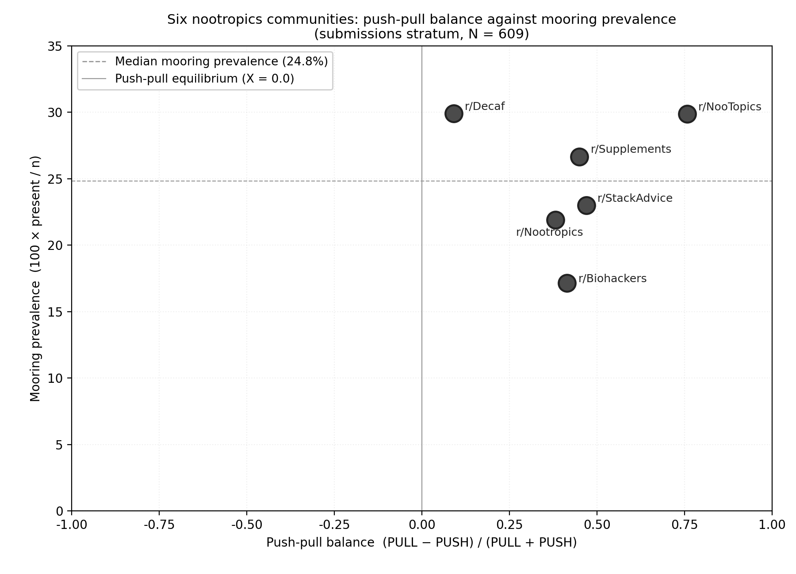

# NootropicRedditScrapePPM

MSc Management thesis, Modul University Vienna, 2026 (91/100). Author: Vladislav Dolgov. Supervisor: Dr. Lyndon Nixon.

The thesis applies the Push-Pull-Mooring (PPM) migration framework to consumers switching from caffeine and stimulants to nootropics. Reddit posts and comments from six communities (2020 to 2025) were coded by a local LLM against a PPM codebook, and each community was placed on a perceptual map.



## Results

Certified corpus: 50,044 units (609 submissions, 49,435 comments). The map uses the 609 submissions.

| Community | N | Push-pull balance | Mooring prevalence (%) | Archetype |
|---|---|---|---|---|
| r/NooTopics | 87 | +0.758 | 29.9 | Facilitator-Embedded Wellness Seeker |
| r/Supplements | 105 | +0.450 | 26.7 | Facilitator-Embedded Wellness Seeker |
| r/StackAdvice | 100 | +0.469 | 23.0 | Self-Directed Natural Optimiser |
| r/Nootropics | 105 | +0.381 | 21.9 | Self-Directed Natural Optimiser |
| r/Biohackers | 105 | +0.415 | 17.1 | Self-Directed Natural Optimiser |
| r/Decaf | 107 | +0.091 | 29.9 | Caffeine/Stimulant Escapee |

Push-pull balance is (PULL − PUSH) / (PULL + PUSH). Mooring prevalence is the share of submissions with any mooring code.

All six communities read net-pull. r/Decaf is the exception in degree: push (40) nearly matches pull (48). Mooring then splits the rest, highest in r/NooTopics and r/Supplements, lowest in r/Biohackers.

Inter-rater agreement was slight (Cohen's kappa 0.115 Llama–researcher, 0.151 Gemma–researcher, 0.047 Llama–Gemma), so the archetypes are an interpretive, community-level reading rather than a measurement.

## Method

1. **Collection.** BigQuery extraction under Reddit's Research Data Addendum, filtered by score and length, stratified to 660 posts with their comment threads.
2. **Coding.** Llama 3.1 via Ollama, six parallel workers (`scripts/bqah_coder.py`, codebook in `modules/codebook.py`).
3. **Reliability.** Researcher-coded subsample, second rater Gemma 3 12B (`scripts/calculate_irr_kappa.py`).
4. **Map.** Per-community counts frozen to `outputs/frozen_*.json`, rendered by `perceptual_map.py`.

Extraction parameters: [`docs/bqah_extraction_reference.md`](docs/bqah_extraction_reference.md). Architecture: [`docs/ARCHITECTURE.md`](docs/ARCHITECTURE.md).

## Demo

The repo holds no Reddit data. A synthetic dataset runs the pipeline end to end:

```bash
pip install -e .                          # Python 3.11+
python scripts/verify_install.py
python scripts/generate_mock_ppm_data.py
streamlit run app.py
```

Ollama setup: [`SETUP.md`](SETUP.md). Data-agreement compliance: [`COMPLIANCE.md`](COMPLIANCE.md).

## Citation

```bibtex
@software{dolgov2026caffeine,
  author      = {Dolgov, Vladislav},
  title       = {Caffeine to Brain Boosts: A Qualitative Research Instrument for Nootropic Discourse Analysis},
  institution = {Modul University Vienna},
  year        = {2026},
  url         = {https://github.com/Hotpopize/NootropicRedditScrapePPM}
}
```

MIT licence. Contact: [LinkedIn / email here]
